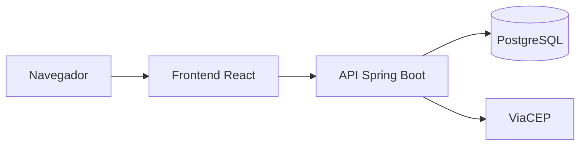

# Cadastro de usuários e endereços

Aplicação fullstack para cadastro de usuários e gerenciamento de endereços. O CEP preenche logradouro, bairro, cidade e estado pela API pública [ViaCEP](https://viacep.com.br/). Há dois perfis: **usuário comum**, que gerencia os próprios dados, e **administrador**, que consulta e gerencia todos os usuários.

## Tecnologias

**Backend:** Java 21, Spring Boot, Clean Architecture, Spring Security (JWT + Argon2), Spring Data JPA, PostgreSQL, Bean Validation

**Frontend:** React, TypeScript, Vite, Redux Toolkit, Styled-Components, Axios



## Como executar

Pré-requisitos: Docker e Docker Compose.

```bash
git clone <url-do-repositorio>
cd <pasta-do-projeto>
cp .env.example .env
```

O arquivo `.env` não vai para o GitHub. Edite-o antes de subir:

1. Gere o JWT (mínimo 32 caracteres): `openssl rand -hex 48`
2. Cole o valor em `JWT_SECRET`
3. Troque `DB_PASSWORD`, `SEED_ADMIN_PASSWORD` e `SEED_USER_PASSWORD`

As senhas de demonstração precisam ter 8+ caracteres, com 1 maiúscula, 1 minúscula, 1 número e 1 caractere especial.

```bash
docker compose up --build
```

Na primeira execução o build pode levar alguns minutos. O backend espera o PostgreSQL; o frontend espera o backend.

| Serviço | Endereço |
| --- | --- |
| Frontend | http://localhost:3000 |
| API | http://localhost:8080 |
| PostgreSQL | localhost:5432 (credenciais do `.env`) |

Para parar: `docker compose down`. Para apagar também os dados do banco: `docker compose down -v`.

### Contas de demonstração

Criadas na primeira inicialização, com as senhas do `.env`:

| Perfil | CPF | Senha |
| --- | --- | --- |
| Administrador | 390.533.447-05 | `SEED_ADMIN_PASSWORD` |
| Usuário comum | 529.982.247-25 | `SEED_USER_PASSWORD` |

Novas contas são criadas na tela de cadastro. O CPF precisa ser válido.

## Funcionalidades

### Autenticação e cadastro

- Login com CPF e senha
- Cadastro com nome, CPF, data de nascimento, senha e tipo de perfil
- Senha forte validada no frontend e no backend
- Senhas armazenadas com hash Argon2
- CPF duplicado retorna mensagem genérica, sem confirmar se a conta já existe

### Painel do usuário comum

- Dados pessoais: nome, CPF, data de nascimento e perfil
- Formulário de endereço com preenchimento automático via CEP
- Lista de endereços (CEP, logradouro, número, complemento, bairro, cidade, estado e principal)
- O primeiro endereço vira o principal. Ao marcar outro, um modal confirma qual deixa de ser o principal
- Exclusão com confirmação. Se o principal for excluído, o sistema informa o próximo ou avisa que não haverá principal
- Alertas visuais para cadastro, atualização, exclusão e definição de principal
- O usuário comum cria, exclui e escolhe o principal; não edita endereços já salvos

### Painel do administrador

- Lista de usuários com busca por nome ou CPF
- Ao gerenciar um usuário, vê os dados completos e os endereços
- Pode adicionar, editar, excluir e definir o endereço principal de qualquer usuário
- Só administradores acessam essa listagem
- No header, o nome volta ao perfil; o link **Painel do administrador** abre a lista de usuários

## Estrutura

```
backend/            API Spring Boot
frontend/           Aplicação React
docker-compose.yml
.env.example        modelo das variáveis (sem segredos)
.env                valores locais (não versionado)
```

Backend (`com.project.backend`):

- `domain` — modelos e contratos (ports)
- `usecase` — regras de negócio
- `infrastructure` — persistência, ViaCEP, segurança e configurações
- `web` — controllers, DTOs e erros

Frontend (`frontend/src`): `components`, `pages`, `store`, `services`, `styles` e `utils`.

O Redux Toolkit guarda login, usuários e endereços num só lugar, porque o header, o dashboard e o painel admin leem o mesmo estado.
